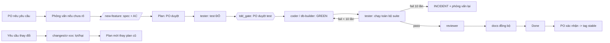

# Template hệ thống: .NET · PostgreSQL · Next.js · (LLM qua cổng trừu tượng)

Claude chính (orchestrator, kiêm Tech Lead + PM) nhận yêu cầu từ bạn (PO), phỏng vấn khi chưa rõ, lập plan chờ bạn duyệt, rồi giao việc cho agent phụ theo vùng ghi riêng. Luật đầy đủ: `CLAUDE.md`. Profile dự án: `documents/PROJECT.md`.

## Cấu trúc
```
.claude/      AI quản lý (không lên git): agents/ skills/ templates/ hooks/ agent-zones.json settings.json
                optional/agents/ = mobile-coder, designer (chép sang agents/ khi bật module)
.running/     AI và agent quản lý (không lên git)
                tasks/    kế hoạch giao cho từng agent        results/  kết quả mỗi lần chạy, giữ lịch sử
                shares/   tài nguyên chia sẻ giữa agent       latest_state.md  bộ nhớ liên phiên (đọc đầu phiên)
documents/    bạn xem và sửa được
                designs/  features, adr, ui, (srs, frs, erd, api, testing ...)
                plans/    master.md, tuần, ngày/phiên        reports/  báo cáo mỗi plan, INCIDENT, CHANGELOGS.md
                changes/  yêu cầu thay đổi + phân tích lợi/hại      total_report.md  báo cáo tổng cho bạn
                PROJECT.md  BUILD.md  document-registry.md
source/       backend/ (+tests/) · frontend/ (+tests/) · resources/ · tests/ (e2e, tải) · deploys/ (docker, compose, guides)
.github/      CI/CD
```
`.claude/` và `.running/` đã nằm trong `.gitignore`: chỉ `source/` và `documents/` lên git, nên tag `stable` đóng băng code cùng tài liệu. Mất `.running/latest_state.md` là mất bộ nhớ liên phiên, hãy sao lưu thư mục này nếu cần.

## Luồng làm việc

- **Đầu phiên:** Claude chỉ đọc `.running/latest_state.md` rồi `documents/PROJECT.md`, liệt kê việc còn dở.
- **Cuối phiên:** cập nhật plan, report, `latest_state.md`; xong một plan thì cập nhật `documents/total_report.md` cho bạn.
- **Yêu cầu thay đổi:** viết `documents/changes/cr-xxx` kèm phân tích, bạn quyết, được duyệt thì sinh plan mới thay plan cũ.

## Skill
| Skill | Profile | Việc |
|---|---|---|
| /init-project | - | phỏng vấn, điền PROJECT.md, master plan, dựng khung, xác minh lệnh build/test |
| /new-feature | mọi | feature spec F-xxx với acceptance criteria |
| /tdd | mọi | điều phối red -> gate -> green -> verify -> review |
| /review-code | mọi | reviewer 4 trục, chỉ đọc |
| /update-changelog | mọi | nháp CHANGELOG.md từ commit (không tag, không commit) |
| /promote-stable | mọi | git tag `stable-...` sau khi PO xác nhận |
| /design-to-code | figma on | Figma -> component theo TDD |
| /analyze-requirements, /design-module, /gen-testcases | standard+ | SRS, FRS, test case |
| /breakdown, /impact-analysis, /sync-trace | full | WBS/Jira, phân tích thay đổi sâu, traceability |

## Bắt đầu
1. Chép thư mục này làm gốc repo, `git init`, commit đầu. Cần Node (hook) và Claude Code; .NET SDK, Docker, Git theo `documents/PROJECT.md`.
2. Chạy `claude` tại thư mục gốc. `/hooks` thấy 2 hook, `/agents` thấy 7 agent.
3. Phiên 1: gõ `/init-project`. Claude phỏng vấn, lập master plan và plan đầu, chờ bạn duyệt rồi mới dựng khung.
4. Kiểm tra hook một lần: nhờ `Dùng agent tester thử ghi file source/backend/x.txt (kỳ vọng bị chặn) rồi ghi source/tests/x.txt (kỳ vọng thành công), sau đó xóa cả hai.`
5. Từ phiên 2: Claude tự đọc `latest_state.md` và liệt kê việc còn dở.

## Quyền trong `.claude/`
Claude tự tạo và sửa agents, skills, templates. Cần bạn đồng ý khi sửa `settings.json`, `agent-zones.json`, `hooks/`, `CLAUDE.md`, `README.md`, vì nếu AI tự sửa được các file này thì việc chặn ghi sai vùng mất tác dụng.

## Khác với bản trước
- Cấu trúc theo sơ đồ của bạn: `.running` (tasks, results, shares, latest_state.md), `documents` (designs, plans, reports, changes, total_report.md), `source` (frontend, backend, resources, tests, deploys). Thư mục `resouces` trong sơ đồ đã đổi thành `resources`.
- Test .NET và Vitest nằm trong từng hệ thống (`source/backend/tests`, `source/frontend/tests`); `source/tests` chỉ cho test ngoài.
- Kết quả agent giữ lịch sử: `.running/results/<task>-<lần>.md`, không ghi đè.
- Bộ nhớ liên phiên là một file duy nhất (`latest_state.md`), thay cho việc đọc CHANGELOGS + report + plan.

## Giới hạn cần biết (hook đã chạy thử bằng tình huống giả lập, chưa chạy trong Claude Code thật)
- Hook chỉ chặn công cụ Write/Edit. Agent có Bash vẫn ghi được bằng lệnh shell; Claude chính kiểm tra bằng `git status --porcelain` và `find .claude -newer ...` sau mỗi agent.
- Hook nhận biết agent phụ qua `agent_type` trong dữ liệu hook; bước 4 ở trên xác nhận điều này trên phiên bản của bạn. Nếu cả phiên chính cũng bị chặn, báo lại để chỉnh `guard.mjs`.
- Agent không có trong `agent-zones.json` (ví dụ general-purpose) bị chặn ghi hoàn toàn.
- Lệnh hook dùng `$CLAUDE_PROJECT_DIR` trong shell kiểu bash (Git Bash trên Windows). Nếu hook báo lỗi đường dẫn, sửa `command` trong `.claude/settings.json`.
- Docker healthcheck của backend dùng `wget`; image runtime có thể không có, `devops` kiểm tra ở bước khởi tạo.
- Sửa `.claude/agents/` thì khởi động lại phiên để nạp lại.
